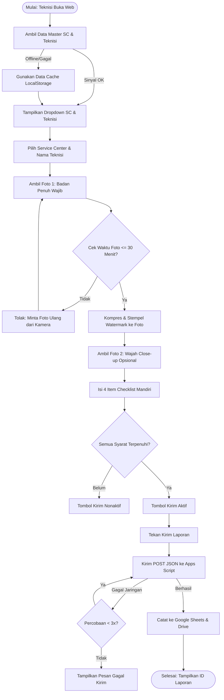

# Monitoring Grooming Teknisi After Sales

Sistem web berbasis *mobile-first* untuk memantau kerapian, penampilan, dan kelengkapan seragam teknisi **MODENA After Sales** secara berkala setiap minggu sebelum kunjungan servis pertama.

---

## 📌 Daftar Isi
- [Latar Belakang & Tujuan](#-latar-belakang--tujuan)
- [Fitur Utama](#-fitur-utama)
- [Alur Kerja Sistem](#-alur-kerja-sistem)
- [Arsitektur & Teknologi](#-arsitektur--teknologi)
- [Spesifikasi Teknis & Payload Data](#-spesifikasi-teknis--payload-data)
- [Panduan Konfigurasi & Deployment](#-panduan-konfigurasi--deployment)
- [Panduan Penggunaan Teknisi](#-panduan-penggunaan-teknisi)
- [Troubleshooting & FAQ](#-troubleshooting--faq)

---

## 🎯 Latar Belakang & Tujuan

Sebagai representasi langsung brand MODENA di hadapan pelanggan, teknisi After Sales diwajibkan selalu berpenampilan rapi, bersih, dan sesuai standar SOP perusahaan. 

Aplikasi ini dirancang untuk:
1. **Memastikan Kepatuhan SOP Grooming**: Memastikan seluruh teknisi mengenakan seragam resmi, celana kerja standar, serta berpenampilan rapi (rambut dan wajah).
2. **Verifikasi Real-time & Anti-Fraud**: Mencegah pengiriman foto lama/arsip galeri dengan validasi metadata waktu tangkapan kamera secara langsung.
3. **Audit Trail Terintegrasi**: Menyematkan *watermark* digital (identitas teknisi, Service Center, waktu lokal WIB, label foto) langsung pada gambar dan menyimpannya otomatis ke Google Sheets / Google Drive.

---

## 🚀 Fitur Utama

### 1. Data Teknisi Dinamis & Caching Cerdas
- Memuat daftar **Service Center (SC)** dan teknisi aktif secara real-time dari master database Google Sheets.
- **Offline Fallback / Caching**: Menggunakan `localStorage` (`grooming_master_v2`) sehingga form tetap dapat dibuka saat teknisi berada di area dengan sinyal internet yang kurang stabil.
- Mendukung pembedaan teknisi dengan nama kembar pada cabang yang sama secara otomatis melalui ID Teknisi unik.

### 2. Validasi Tangkapan Kamera & Anti-Galeri
- Mengarahkan input kamera secara langsung (`capture="environment"` untuk badan penuh dan `capture="user"` untuk close-up wajah).
- **Anti-Galeri (Freshness Check)**: Memvalidasi selisih waktu berkas (`lastModified`). Foto yang diambil lebih dari 30 menit sebelum pengiriman akan otomatis ditolak untuk memastikan foto baru dan otentik.

### 3. Kompresi Gambar & Watermark Otomatis (Client-Side Canvas)
- **Kompresi Dinamis**: Mengubah ukuran foto (maksimal resolusi sisi 1280px) dan kompresi JPEG progresif (target ukuran $\le$ 350 KB) untuk menghemat kuota dan mempercepat pengiriman data di jaringan seluler.
- **Visual Watermark Stamp**: Menempelkan pita identitas di bagian bawah foto secara otomatis sebelum diunggah:
  - Nama dan ID Teknisi
  - Nama Service Center
  - Waktu Pengambilan (Format: `DD/MM/YYYY HH:mm WIB`)
  - Label Foto (`Badan penuh` / `Wajah`)

### 4. Checklist Evaluasi Mandiri (Self-Assessment)
Teknisi wajib mengisi 4 poin pemeriksaan mandiri secara jujur:
- **Seragam**: Seragam resmi MODENA, bersih, tidak kusut atau pudar.
- **Celana**: Celana kerja sesuai standar dan bersih.
- **Rambut**: Pendek, rapi, dan bersih.
- **Wajah**: Kumis dan jenggot dicukur atau dirapikan.

### 5. Validasi Periode & Indikator Hari Senin
- Penghitungan otomatis minggu kerja standar ISO 8601 (`YYYY-Www`).
- Indikator peringatan jika formulir diakses di luar hari Senin.

### 6. Mekanisme Pengiriman Tangguh (Retry & Anti-Duplikasi)
- Indikator progress langkah (Langkah 1: Data $\rightarrow$ Langkah 2: Foto $\rightarrow$ Langkah 3: Checklist).
- Pengiriman data menggunakan *simple request* POST tanpa overhead preflight CORS.
- **Auto-Retry**: Melakukan percobaan pengiriman ulang hingga 3 kali otomatis saat terjadi gangguan koneksi sesaat.
- Server memvalidasi agar setiap teknisi hanya mengirimkan 1 laporan per minggu.

---

## 🔄 Alur Kerja Sistem



---

## 🛠 Arsitektur & Teknologi

| Komponen | Teknologi | Keterangan |
| :--- | :--- | :--- |
| **Frontend** | Single File HTML5, Modern CSS3, Vanilla JS | Bebas dependensi eksternal, ringan, cepat dimuat pada perangkat Android/iOS |
| **Kompresi & Canvas** | HTML5 Canvas API | Kompresi citra JPEG dan pembuatan watermark secara native di browser |
| **Penyimpanan Lokal** | Web Storage API (`localStorage`) | Cache data master teknisi untuk toleransi jaringan lemah |
| **Backend API** | Google Apps Script (Web App) | Menerima payload, validasi duplikasi mingguan, dan penyimpanan data |
| **Database** | Google Sheets | Lembar `Master_Teknisi` dan tabel transaksi pelaporan |
| **Storage Gambar** | Google Drive / Apps Script blob | Menyimpan berkas foto hasil watermark |

---

## 📋 Spesifikasi Teknis & Payload Data

### 1. Request Data Master (GET)
Digunakan saat halaman pertama kali dimuat untuk mengisi dropdown Service Center dan Teknisi:
```http
GET https://script.google.com/macros/s/{SCRIPT_ID}/exec?action=master
```
**Contoh Respons Sukses:**
```json
{
  "ok": true,
  "data": {
    "SC Jakarta Barat": [
      { "id": "TEK-001", "name": "Budi Santoso" },
      { "id": "TEK-002", "name": "Agus Setiawan" }
    ],
    "SC Surabaya": [
      { "id": "TEK-015", "name": "Rudi Hartono" }
    ]
  }
}
```

### 2. Pengiriman Laporan Grooming (POST)
Dikirim saat teknisi menekan tombol **Kirim laporan grooming**:
```http
POST https://script.google.com/macros/s/{SCRIPT_ID}/exec
Content-Type: text/plain;charset=UTF-8
```
**Payload Body (JSON):**
```json
{
  "action": "submit",
  "sc": "SC Jakarta Barat",
  "idTeknisi": "TEK-001",
  "answers": {
    "seragam": "Ya",
    "celana": "Ya",
    "rambut": "Ya",
    "wajah": "Ya"
  },
  "foto1": "/9j/4AAQSkZJRgABAQAAAQABAAD...",
  "foto2": "/9j/4AAQSkZJRgABAQAAAQABAAD...",
  "clientTime": "2026-11-09T01:15:30.000Z",
  "userAgent": "Mozilla/5.0 (Linux; Android 14; SM-A546E)..."
}
```
**Contoh Respons Sukses:**
```json
{
  "ok": true,
  "weekId": "2026-W46",
  "timing": "Tepat waktu",
  "submissionId": "GRM-202646-0042"
}
```

---

## ⚙️ Panduan Konfigurasi & Deployment

### 1. Konfigurasi Frontend (`index.html`)
Buka file [index.html](file:///d:/PROJECT/Monitoring-Grooming/index.html) dan sesuaikan konstanta konfigurasi pada baris `CONFIG`:

```javascript
const CONFIG = {
  // Ganti dengan URL Web App Google Apps Script deployment Anda
  SCRIPT_URL: "https://script.google.com/macros/s/AKfycb.../exec",
  
  // Batas usia foto maksimum (dalam menit) sebelum ditolak
  MAX_PHOTO_AGE_MIN: 30,
  
  // Resolusi maksimum sisi terpanjang foto (pixel)
  PHOTO_MAX_SIDE: 1280,
  
  // Target estimasi ukuran berkas foto setelah dikompres (KB)
  PHOTO_MAX_KB: 350
};
```

### 2. Persyaratan Spreadsheet & Backend Google Apps Script
1. Buat Google Spreadsheet baru.
2. Buat sheet bernama `Master_Teknisi` dengan struktur kolom:
   - `ID_Teknisi` | `Nama_Teknisi` | `Service_Center` | `Aktif` (`Ya` / `Tidak`)
3. Buat sheet transaksi untuk menampung riwayat pelaporan:
   - `Timestamp` | `Submission_ID` | `Week_ID` | `Service_Center` | `ID_Teknisi` | `Nama_Teknisi` | `Seragam` | `Celana` | `Rambut` | `Wajah` | `Link_Foto_1` | `Link_Foto_2` | `User_Agent`
4. Buat script pada menu **Extensions > Apps Script**, masukkan kode penanganan `doGet()` dan `doPost()`.
5. Deploy skrip melalui **Deploy > New deployment > Web app**:
   - **Execute as**: *Me (pemilik akun)*
   - **Who has access**: *Anyone* (siapa saja)
6. Salin URL Web App yang dihasilkan (berakhiran `/exec`) ke dalam variabel `CONFIG.SCRIPT_URL` di `index.html`.

### 3. Menjalankan / Hosting Web App
Aplikasi ini berupa halaman web statis, sehingga dapat di-hosting secara mudah melalui:
- **GitHub Pages**: Cukup aktifkan GitHub Pages dari branch utama (`main`).
- **Web Server Lokal**: Gunakan ekstensi seperti VS Code Live Server, atau via command prompt:
  ```powershell
  python -m http.server 8080
  ```
  Lalu buka `http://localhost:8080` di browser.

---

## 📱 Panduan Penggunaan Teknisi

1. **Jadwal Pelaporan**:
   - Lakukan pelaporan setiap hari **Senin pagi** sebelum melakukan kunjungan servis pertama ke rumah pelanggan.
2. **Langkah-langkah Pengisian**:
   - Buka tautan formulir pada peramban ponsel (Chrome/Safari).
   - Pilih **Service Center** penugasan dan **Nama Teknisi**.
   - Ambil **Foto 1 (Badan Penuh)**: Pastikan berdiri tegak di depan cermin atau minta bantuan rekan kerja. Seluruh badan dari ujung kepala hingga sepatu harus terlihat jelas bersama seragam MODENA.
   - Ambil **Foto 2 (Close-up Wajah)** *(opsional)* untuk memperlihatkan kerapian rambut dan wajah.
   - Isi evaluasi mandiri pada 4 pertanyaan checklist.
   - Tekan tombol **Kirim laporan grooming**.
3. **Konfirmasi**:
   - Pastikan muncul notifikasi hijau bertuliskan **Laporan terkirim** beserta **ID Laporan**.

---

## ❓ Troubleshooting & FAQ

> [!NOTE]
> **Daftar Service Center tidak muncul?**  
> Pastikan ponsel terhubung ke jaringan internet dan URL Web App Google Apps Script dapat diakses. Jika sinyal sempat terputus, muat ulang halaman saat sinyal kembali stabil.

> [!WARNING]
> **Foto ditolak dengan pesan "Foto ini diambil X menit lalu"?**  
> Sistem mendeteksi foto yang diunggah bukan foto langsung dari kamera (atau merupakan foto lama dari galeri). Ambil foto baru secara langsung melalui tombol kamera pada halaman.

> [!IMPORTANT]
> **Laporan tidak bisa dikirim dua kali?**  
> Server membatasi 1 laporan per teknisi per minggu kalender ISO. Jika ada kesalahan data atau seragam yang perlu diganti, hubungi Admin Cabang After Sales untuk peninjauan lebih lanjut.

---

## 📄 Lisensi & Hak Cipta
&copy; 2026 PT MODENA Indonesia — Divisi After Sales. Dilindungi oleh hak cipta.
